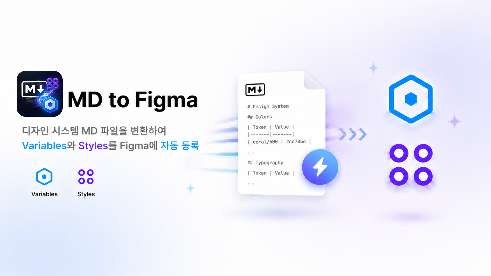
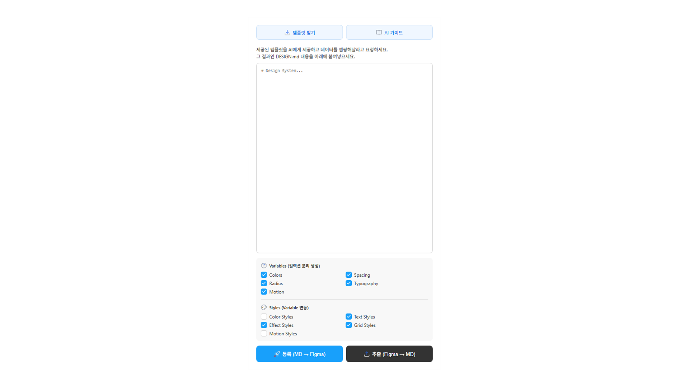
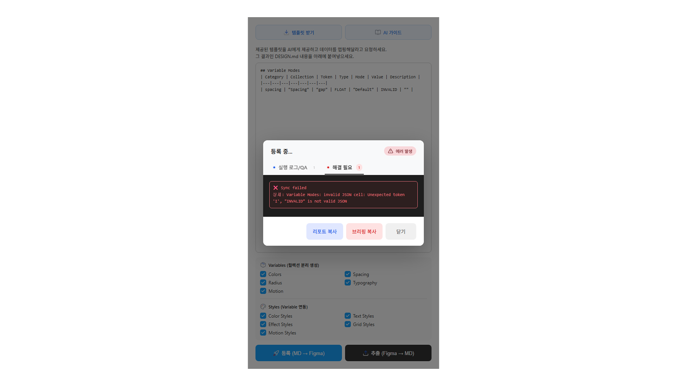
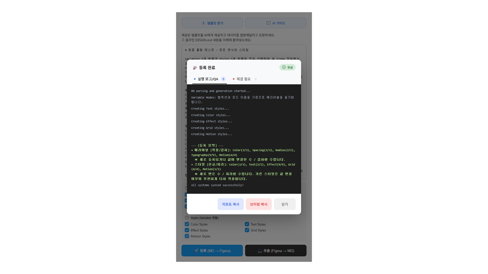
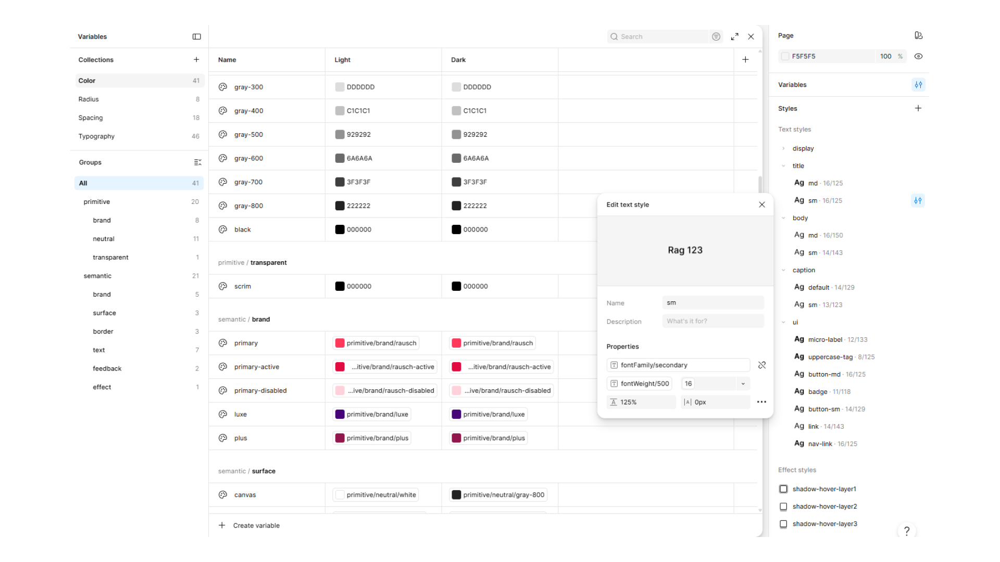

# 📦 MD to Figma

**The Complete Bidirectional Design System Engine — Variables, Styles, and Data Extraction at Once!!**

Figma plugin that synchronizes your entire design system between Markdown and Figma. 
Create Variables & Styles from MD, or export your existing Figma system back to MD — with smart bindings and zero configuration.

[](https://www.figma.com/community/plugin/YOUR_PLUGIN_ID)




---

## 💡 MD to Figma를 쓰는 이유

1. **AI 워크플로우 최적화**: AI가 생성한 `DESIGN.md`를 피그마에 즉시 무료로 이식합니다. MCP의 토큰 낭비 없이 대규모 시스템을 구축하세요.
2. **양방향 동기화 (Bidirectional)**: 피그마에 구축된 복잡한 변수와 스타일을 다시 마크다운 문서로 정밀하게 추출(Export)할 수 있습니다.
3. **시멘틱 디자인 보존**: 폰트가 시스템에 없더라도 사용자의 원래 '디자인 의도'는 배리어블에 영구 보존하고, 화면은 안전한 폴백 폰트로 렌더링합니다.

```
AI / Documentation  ⇄  DESIGN.md  ⇄  MD to Figma  ⇄  Figma Variables & Styles
                                   (양방향, 자동화)
```

---

## ✨ Key Features

### 🔄 1. The Bidirectional Engine
- **MD → Figma (Generate)**: 마크다운 테이블을 분석하여 변수(Variables)와 스타일(Styles)을 완벽한 계층 구조로 자동 생성합니다.
- **Figma → MD (Export)**: 피그마의 기존 변수와 스타일을 다시 깨끗한 마크다운 문서로 추출합니다. 참조가 끊긴 데이터는 `recovered/` 토큰으로 지능적으로 자동 복구합니다.

### 🏛️ 2. Semantic Typography Architecture
- **의도 vs 구현 분리**: `fontFamily/primary`에는 사용자의 고유 폰트(디자인 의도)를, `fontFamily/secondary`에는 `Inter`(안전망)를 자동 할당합니다.
- **지능형 바인딩**: 폰트가 없을 경우 취소선(Missing Font) 에러를 방지하기 위해 자동으로 `secondary` 폴백 변수에 스타일을 바인딩합니다.
- **Smart LineHeight**: `%`와 `px`의 차이를 구분하여, 웹 호환성이 필요한 퍼센트 수치는 바인딩을 풀고 직접 주입하여 정밀도를 100% 보존합니다.

### 🧠 3. Smart Sync & Fuzzy Matching
- **기존 구조 존중 (Smart Update)**: 새로운 변수를 무조건 생성하는 대신, 피그마 파일 내의 모든 컬렉션을 검색하여 동일한 이름의 토큰이 있다면 해당 위치에서 **값만 업데이트**합니다. 디자이너가 커스텀하게 구축한 컬렉션 구조를 파괴하지 않습니다.
- **지능형 이름 매칭 (Fuzzy Match)**: 마크다운에 `primitive/blue`라고 적혀있어도 피그마에 `blue`라는 이름의 변수가 있다면 이를 동일한 토큰으로 인식하여 연결합니다. 접두어(`primitive/`, `semantic/`) 유무에 상관없이 유연하게 대응합니다.
- **하이브리드 추출**: 변수(Variables)뿐만 아니라 일반 스타일(Styles) 정보까지 지능적으로 탐색하여 마크다운으로 추출합니다.
- **AI-Ready QA Report**: 데이터가 비어있을 경우, 사용자가 AI에게 바로 복사해서 전달할 수 있는 '복구용 프롬프트'를 제공하여 끊임없는 순환 구조를 보장합니다.

---

## 📸 Screenshots

UI and report screenshots show the current plugin UI rendered in a local browser.
Report examples use the final sample in an automated test harness with a simulated Figma API.
The Figma output image is maintained separately.

| UI | Error Log |
|---|---|
|  |  |
| Intuitive dashboard with Export/Generate support | Error handling with AI briefing copy |

| QA Log | Figma Output |
|---|---|
|  |  |
| Execution summary & Smart Fallback alerts | Perfectly bound Variables & Styles in Figma |

---

## 🚀 How It Works

1. **Collect** your design system data — from a Figma file, brand guidelines, website, or any source.
2. **Download** the `DESIGN-TEMPLATE.md` from the plugin.
3. **Hand both to any AI** (Claude, ChatGPT, etc.) — the AI uses the template as a pattern reference to organize your data.
4. **Paste** the AI-generated DESIGN.md into the plugin.
5. **Select** which Variables and Styles to generate.
6. **Click Generate** — done. (Use **Export** to extract it back later!)

---

## Figma Agent 스킬로 MD 준비하기

[MD to Figma Assistant](https://www.figma.com/community/skill/142125/runa-md-to-figma)를 Figma Agent에 추가하면 기존 Export MD나 디자인 자료를 플러그인 입력 형식으로 정리할 수 있습니다. 플러그인 상단의 **AI 스킬 ↗** 버튼으로 커뮤니티 페이지를 열 수 있습니다.

1. 스킬을 추가한 뒤 Figma Agent 대화에서 `/runa-md-to-figma`를 호출하고 원본 자료를 첨부합니다.
2. 원하는 변경을 요청하고 완성된 MD, 변경점과 필요한 Variables / Styles 선택을 확인합니다.
3. MD를 기존 플러그인에 붙여넣어 Generate하고, QA 로그와 실제 값·모드·참조·바인딩을 확인합니다.

기존 템플릿·AI 가이드 방식도 계속 사용할 수 있습니다. 스킬은 MD 작성을 돕고, 대상 파일 선택과 등록·결과 확인은 사용자가 진행합니다.

## 📖 Resources

| File | Description |
|---|---|
| [DESIGN-TEMPLATE.md](./resources/DESIGN-TEMPLATE.md) | Token template with formatting rules and examples |
| [AI-PROMPT-GUIDE.md](./resources/AI-PROMPT-GUIDE.md) | Ready-to-use prompts for filling the template with AI |
| [FINAL-INTEGRATION-SAMPLE.md](./resources/FINAL-INTEGRATION-SAMPLE.md) | Final sample covering variables, modes, styles, bindings, and Motion |

> Raw links for in-plugin download:
> - `https://raw.githubusercontent.com/YOUR_USERNAME/md-to-figma/main/resources/DESIGN-TEMPLATE.md`
> - `https://raw.githubusercontent.com/YOUR_USERNAME/md-to-figma/main/resources/AI-PROMPT-GUIDE.md`

---

## 🗂 Repository Structure

```
md-to-figma/
├── code.js                      # Plugin main logic (ES6 Standard)
├── ui.html                      # Plugin UI & Modals
├── manifest.example.json        # Manifest template (rename and fill in your plugin ID)
├── .gitignore                   # manifest.json excluded
├── README.md
└── resources/
    ├── DS/                      # Design System Specifications
    │   ├── MD-TO-FIGMA-FOUNDATION.md # Foundation tokens
    │   └── MD-TO-FIGMA-COMPONENTS.md # Component Specifications
    ├── DESIGN-TEMPLATE.md       # DESIGN.md template (v2.1.0)
    ├── AI-PROMPT-GUIDE.md       # AI prompt guide (v2.1.1)
    ├── FINAL-INTEGRATION-SAMPLE.md      # Sample output generated from the template
    ├── cover_v2.png             # Plugin cover image
    ├── Icon_v2.png              # Plugin icon
    ├── UI.png                   # Screenshot: Main UI
    ├── ErrorLog.png             # Screenshot: Error Modal
    ├── QALog.png                # Screenshot: QA Log Modal
    └── Variables&Styles.png     # Screenshot: Figma output
```

---

## 🛠 Development

### 모드 보존 업데이트 (작업본)

Export MD의 `## Variable Modes` 표는 변수 동기화의 기준입니다. 각 행에
Category, Collection, Token, Type, Mode, Value, Description을 기록하므로,
임의의 모드 이름과 3개 이상의 모드, 동일 이름의 다른 컬렉션 변수도 구분합니다.
기존 Colors/Spacing/Radius/Typography/Motion 섹션은 요약 및 스타일 생성용입니다.
`Variable Modes` 표가 있는 문서에서는 변수 값을 그 표에서 수정하세요.

- Collection, Token, Mode, Description은 JSON 문자열 (`"Dark"`)로 적습니다.
- Value는 JSON 값입니다. FLOAT는 숫자, STRING은 문자열, COLOR는 RGBA 객체,
  TIMING은 초 단위 숫자, EASING은 Figma MotionEasing 객체입니다.
- 참조는 `{"alias":{"collection":"Color","token":"primitive/blue"}}`로 적습니다.
- 표 안의 파이프 문자는 `&#124;`, 문자열의 줄바꿈은 `\n`으로 적습니다.
- Category는 `colors`, `spacing`, `radius`, `typography`, `motion` 중 하나이며
  UI의 변수 선택 옵션을 따릅니다. Export의 카테고리 자동 분류가 다른 경우 수정할 수 있습니다.
- 기존 컬렉션과 변수는 정확한 이름으로 매칭하고 모드는 이름으로 매칭합니다.
  MD에 없는 기존 모드와 변수는 삭제하지 않습니다. 기존 기본 모드도 유지합니다.
  새 컬렉션은 표에 먼저 나오는 모드가 기본 모드가 됩니다.
- 모드 생성 제한, 참조 누락, 값 오류는 QA 로그에 기록합니다. 실패한 모드의 값을
  다른 모드에 대신 쓰지 않습니다. 선택하지 않은 카테고리의 참조 대상은 파일에 있어야 합니다.
- 구버전 MD도 지원합니다. Light/Dark는 모드 이름으로 연결하며 Primitive의 단일 값은
  기본 모드에만 적용합니다. 여러 모드를 같은 값으로 덮어쓰지 않습니다.

이 업데이트는 변수 모드 보존을 다룹니다. 텍스트 스타일의 모드별 생성은 별도 기능이며,
실제 Figma 파일에서 모드 제한과 스타일 동작을 최종 확인해야 합니다.
Color Styles를 선택하면 Variable Modes 표의 COLOR 변수마다 토큰 이름의
컬러 스타일을 생성하거나 갱신합니다. 각 스타일은 변수에 바인딩되므로 소비하는
레이어의 모드를 따릅니다. 모드별로 스타일을 중복 생성하지 않습니다.
MD에 명시된 그룹 경로만 스타일 이름에 사용합니다. 이름 충돌은 자동 그룹 추가 없이 QA로 안내합니다.
Typography의 그룹명은 대소문자를 유지하며, 그룹 없는 스타일의 Export도 그룹을 추가하지 않습니다.
텍스트 스타일에 필요한 폰트명·두께 STRING 변수는 없을 때 보완하고 바인딩합니다.
회귀 테스트: `node --test tests/modes.test.cjs`

### Local Setup

1. Clone the repository
```bash
git clone https://github.com/YOUR_USERNAME/md-to-figma.git
```

2. Copy and configure the manifest
```bash
cp manifest.example.json manifest.json
```
Then replace `YOUR_PLUGIN_ID` in `manifest.json` with your actual Figma plugin ID.

3. Open Figma Desktop → Plugins → Development → Import plugin from manifest
4. Select `manifest.json`

### Publishing

1. Edit `code.js` or `ui.html`
2. Test in Figma Desktop
3. Plugins & Widgets → MD to Figma → ··· → **Publish new version**
4. Write release notes and submit

---

## v2.1.1 릴리즈 노트 (Latest)

### ✨ Figma Agent 스킬 연결과 사용 안내 개선
공개된 MD to Figma Assistant 스킬을 플러그인에서 바로 찾을 수 있도록 연결하고, 스킬로 준비한 MD를 등록하는 과정을 안내합니다. 변수·스타일 등록과 내보내기 형식은 v2.1.0을 유지하는 패치 업데이트입니다.

#### **1. 플러그인에서 AI 스킬 바로 열기**
- **AI 스킬 버튼**: 기존 템플릿·AI 가이드 버튼 옆에 인라인 SVG 아이콘을 사용한 버튼을 추가했습니다. 공개된 Figma Community 스킬 페이지를 엽니다.
- **입력 안내**: Figma Agent에서 `/runa-md-to-figma`를 호출하고 결과 MD를 플러그인에 붙여넣는 흐름을 설명합니다.

#### **2. 가이드와 별도 AI 배포물**
- **안내 통일**: 다운로드되는 AI 가이드와 README에 스킬 추가·호출·등록 방법을 추가하고, 명칭을 Figma Agent로 통일했습니다. 기존 템플릿과 다른 AI를 이용하는 방법도 유지합니다.
- **별도 패키징**: Figma용 단일 MD 스킬, AI 플러그인·독립 스킬 ZIP과 로컬 사전 검사기를 추가했습니다. AI 패키지 버전은 플러그인과 별개인 v0.1.0으로 관리합니다.

#### **3. 검증**
- 기존 등록·내보내기 자동 테스트 9개와 AI 패키지 검사 7개를 통과했습니다. 버튼에서 공개 URL을 여는 메시지 연결과 가이드 다운로드 내용도 확인했습니다.
- Figma Agent 스킬이 반환한 MD의 실제 등록과 참조 보존은 사용자 테스트로 확인했습니다. AI 플러그인 패키지의 호스트 설치 테스트는 별도로 진행합니다.

---

## v2.1.0 릴리즈 노트

### ✨ 다중 모드 보존과 스타일 등록 확장
컬렉션·모드·참조를 보존하는 Variable Modes 형식을 추가하고, 효과·가이드·모션 스타일과 AI 작업 흐름을 확장했습니다.

#### **1. Variable Modes 기반 양방향 동기화**
- **사용자 지정 모드**: Light/Dark 외의 모드 이름과 모드별 값을 그대로 가져오고 내보냅니다. 컬렉션·토큰·모드 이름으로 매칭하며 MD에 없는 기존 항목은 유지합니다.
- **타입과 참조 보존**: COLOR, FLOAT, STRING, BOOLEAN과 선택 기능인 TIMING/EASING을 지원하며, 컬렉션 간 참조와 색상 투명도를 보존합니다.
- **기존 형식 호환**: 기존 표도 지원합니다. Variable Modes 표가 있으면 해당 표를 변수 수정의 기준으로 사용합니다.

#### **2. 스타일과 명시적 변수 바인딩 확장**
- **Color / Text**: 컬러 스타일을 COLOR 변수에 연결하고, 텍스트의 폰트명·두께·크기와 지원되는 행간·자간을 변수에 연결합니다. 토큰 경로와 그룹 대소문자를 보존합니다.
- **Effect / Grid**: 효과 7종과 가이드 3종을 종류별로 정리하고, JSON 설정으로 복합 항목과 순서를 보존합니다. 명시한 속성만 변수에 연결하며 참조 문제가 있으면 정적 값을 사용하고 QA로 안내합니다.
- **Noise 호환성**: Figma 환경별 NORMAL blendMode 스키마 차이에 대응합니다. Noise·Texture·Glass 등 베타 효과의 지원 여부는 실행 환경에 따라 달라질 수 있습니다.

#### **3. 선택형 Motion 지원**
- **변수와 스타일 분리**: TIMING/EASING 변수와 Motion Styles를 각각 선택할 수 있습니다.
- **프리셋 기반 등록**: Export의 프리셋과 설정값을 보존하며 로컬 모션 스타일을 등록합니다. API 미지원 환경은 QA로 안내하고 다른 항목은 계속 처리합니다.

#### **4. 결과 리포트와 AI 자료 정리**
- **처리 결과 중심 로그**: 변수는 적용/검사, 스타일은 신규/처리 수로 표시합니다. 선택돼 있어도 MD에 없는 항목은 생성하지 않습니다.
- **템플릿과 가이드 역할 분리**: 템플릿은 짧은 AI 변환 규칙·데이터·필드 설명으로 구성하고, 상세 작업 안내와 상황별 프롬프트는 AI 가이드로 모았습니다. 설명은 사용자의 언어로 제공하도록 안내합니다.
- **통합 샘플과 검증**: 최종 샘플의 변수 21개·스타일 19개를 실제 Figma에서 등록 → Export → 새 파일 이식 → 같은 파일 재등록까지 확인했습니다. 자동 테스트 9개를 통과했습니다.

---

## v2.0.2 릴리즈 노트 (Old)

### 🐛 MD 추출 버그 해결 및 네이밍 매칭 최적화
피그마 플러그인의 양방향 데이터 내보내기(Export)와 가져오기(Import) 네이밍 매칭 안정성을 강화했습니다.

#### **1. MD 추출(Export) 포맷 정상화**
- **변수 카테고리 분리**: 내보내기 시 Spacing, Radius, Colors를 Primitive와 Semantic 테이블로 완전 분리하여 내보냅니다.
- **접두어 제거**: 내보내는 마크다운의 토큰 이름 및 참조 에일리어스 값에서 `primitive/`, `semantic/` 접두어를 정리하여 내보내도록 하여 재가져오기 시 토큰이 중복 생성되는 현상을 차단했습니다.
- **다중 모드 및 타이포그래피 추적**: 세맨틱 컬러의 다중 모드(Light/Dark) 값을 동시에 내보내며, 텍스트 스타일 내보내기 시 스타일에 바인딩된 최신 변수 값을 직접 추적하여 내보집니다.

#### **2. 슬래시(/) 및 하이픈(-) 네이밍 호환성 최적화 (Fuzzy Match)**
- 피그마의 다중 그룹핑용 슬래시(`/`)와 코드의 하이픈 (`-`) 기호 차이를 매칭 시 메모리 내에서 정규화하여 대조하는 로직을 적용했습니다.
- 기존에 피그마 내에 슬래시나 하이픈으로 정의되어 있던 배리어블의 원래 이름과 폴더 구조를 파괴하지 않고 안전하게 **값만 업데이트**하도록 개선했습니다.

---

## v2.0.1 릴리즈 노트 (Old)

### 🎨 UI Refinement & Design System Documentation
플러그인의 시각적 완성도를 높이고, 개발자와 디자이너 간의 협업을 위한 디자인 시스템 명세를 추가했습니다.

#### **1. UI 고도화 및 최적화**
- **토큰 정규화**: 파편화된 CSS 토큰을 v2.0.1 표준 체계로 정규화하여 유지보수성을 강화했습니다.
- **폐쇄망 환경 대응**: 외부 폰트 의존성을 제거하고 OS별 최적화된 **시스템 폰트 폴백 스택**을 적용했습니다.
- **동적 아이콘 시스템**: 작업 상태에 따라 실시간으로 반응하는 SVG 아이콘 및 애니메이션 로직을 도입했습니다.

#### **2. MD to Figma 제품 디자인 시스템(DS) 명세 추가**
- **Foundation 명세**: 컬러, 간격, 곡률, 타이포그래피 등 시스템의 기초가 되는 토큰 정의서를 제공합니다. (`resources/DS/MD-TO-FIGMA-FOUNDATION.md`)
- **Component 명세**: 7개의 기본 컴포넌트와 4개의 복합 컴포넌트(총 11개)에 대한 상세 API 및 슬롯 아키텍처를 문서화했습니다. (`resources/DS/MD-TO-FIGMA-COMPONENTS.md`)

---

## v2.0.0 릴리즈 노트

### 🚀 대규모 업데이트: The Bidirectional Semantic Engine
v1.6.0 이후의 모든 개발 성과를 집약한 대규모 메이저 업데이트입니다. 텍스트 등록을 넘어선 디자인 시스템의 완전한 관리를 지향합니다.

#### **1. 양방향 엔진 (Figma ⇄ Markdown)**
- **추출(Export) 기능**: 피그마에 구축된 변수와 스타일을 100% 정규화된 마크다운으로 추출합니다.
- **무결성 보존**: 디자이너의 수정 사항을 실시간으로 추적하여 추출하며, 참조가 끊긴 데이터는 자동 복구합니다.

#### **2. 시멘틱 타이포그래피 아키텍처**
- **의도 보존 시스템**: `fontFamily/primary`(디자인 의도)와 `secondary`(실제 폴백)를 분리하여 폰트 부재 시에도 시스템을 보호합니다.
- **스마트 매핑**: `fontWeight/400`과 같은 수치 네이밍과 `Regular`라는 피그마 스타일값을 시멘틱 토큰으로 완벽하게 연결했습니다.
- **지능형 바인딩**: 단위(`px`, `%`)를 스스로 판단하여 피그마 UI가 깨지지 않는 최적의 방식으로 자동 바인딩합니다.

#### **3. 전문가용 QA & 리포팅**
- **에러/QA 분리**: 단순 로그가 아닌, AI에게 전달할 수 있는 전문적인 시스템 분석 리포트를 제공합니다.
- **안정성**: 모든 수치를 소수점 둘째 자리에서 정규화하고, 런타임 크래시를 방지하는 강력한 ES6 표준 방어 로직을 탑재했습니다.

---

## v1.6.0 릴리즈 노트 (Old)

### ✨ 새로운 기능 및 개선
#### **Typography 변수 바인딩 완벽 지원 (Font Family & Weight)**
- 텍스트 스타일 생성 시 폰트 속성이 변수에 정상적으로 바인딩되도록 개선되었습니다.
- **스마트 Font Weight 매핑**: 마크다운 템플릿에 `600`, `semibold`, `midium`(오타) 등 다양한 형태로 두께를 입력하더라도, Figma 표준 명칭으로 자동 변환합니다.

---

## 📄 License

MIT
